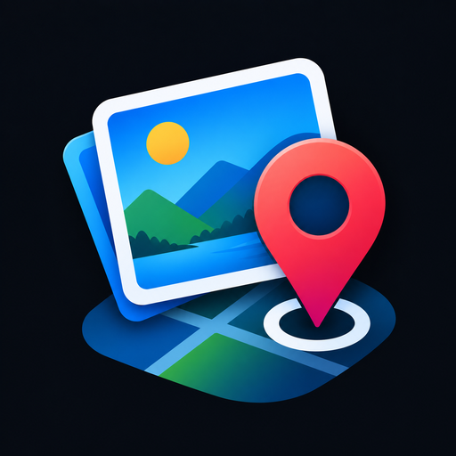

  

<h1 align="center">Photocator</h1>

<b>Every photo, stamped with where it happened.</b>

  

  
  
  

## About

Photocator is a free, open-source Android camera that adds the place, the map, the weather and the time to every photo and video you take. Each shot carries a geotag with GPS coordinates, place name, full address, a map thumbnail, Plus Code, altitude, speed, temperature, humidity, wind and compass heading. It is useful for field work, site inspections, travel logs, deliveries, or any time you want proof of where a picture was taken.

## Features

**Geotag**
- Live geotag over the viewfinder, with the same layout saved onto the photo and burned into every frame of video
- Adjustable size and position, with rounded corners by default (switch to sharp in Settings > Geotag)
- Choose which side of the geotag the map sits on, left or right; the watermark or QR code takes the other side
- Review and edit before saving: address, note, position, or a strip below the photo

**Watermark or QR code**
- Show one of your own watermark logos, or a QR code of the location, in the corner of the geotag (one at a time)
- The QR code opens the location in any maps app and updates when you change the location while editing
- Choose the QR code and background colours in Settings > QR code, with a live preview
- Tap the Watermark / QR tile in the camera quick panel to cycle off, watermark, QR code

**Existing photos**
- Add one geotag to many gallery photos at once, with the same location for all of them
- Pick the location with the map picker and place search, your current location, a saved location, or by typing it in

**Saved locations**
- Save places from the map or by search, name them, and reuse them while editing a photo or adding a geotag to gallery photos
- Open them from the location button next to the Photo / Night / Video selector

**Maps**
- Choose a map provider in Settings > Map: Esri (default), OpenStreetMap or OpenTopoMap, each with its own styles
- Adjustable map zoom for the geotag thumbnail

**Camera**
- Photo, Night and Video modes, with better low-light video
- Zoom dial (tap the empty viewfinder to close it), flash, timer, grid, aspect ratio, quality, volume-button shutter or zoom
- Refresh your location from the button beside the mode selector

**Photos and videos**
- Full-screen photo and video viewer with back, share and delete, like a gallery app
- Select several items to share or delete, or rename them

**Privacy**
- No accounts, no ads, no analytics. Your photos and saved locations stay on your phone

## Download
[Download the APK directly](https://github.com/karthikhegde25/Photocator/releases/download/1.0/Photocator.apk) or see the [release page](https://github.com/karthikhegde25/Photocator/releases/tag/1.0). Requires Android 8.0 (API 26) or later.

## Build
- JDK 17, Android SDK 35. Run `./gradlew assembleDebug`, or use the GitHub Actions workflow in `.github/workflows/build.yml`.
- For signed releases add the repository secrets used by the workflow (`KEYSTORE_BASE64` and the related password/alias secrets).

## Data sources
- QR codes: ZXing (Apache 2.0)
- Map imagery: Esri and its data providers (default), © OpenStreetMap contributors, OpenTopoMap (CC-BY-SA). Choose the provider and style in Settings > Map
- Addresses and place search: © OpenStreetMap contributors (Nominatim, Photon)
- Weather: Open-Meteo

## License
Copyright © 2026 Karthik Hegde.

Photocator is free software: you can redistribute it and/or modify it under the terms of the [GNU General Public License v3.0](LICENSE) as published by the Free Software Foundation. It is distributed in the hope that it will be useful, but WITHOUT ANY WARRANTY; without even the implied warranty of MERCHANTABILITY or FITNESS FOR A PARTICULAR PURPOSE.
